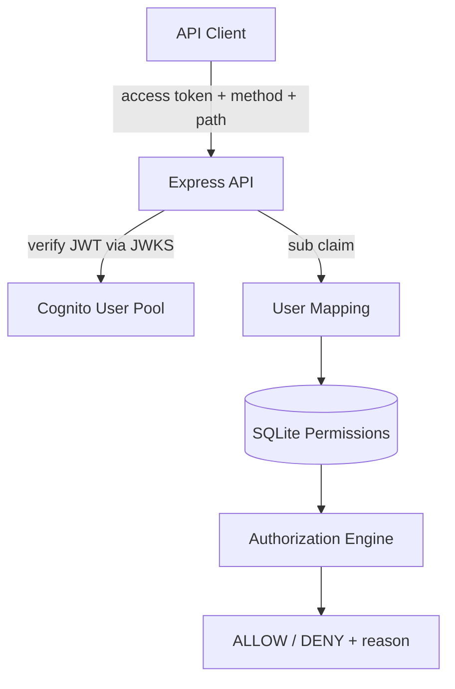
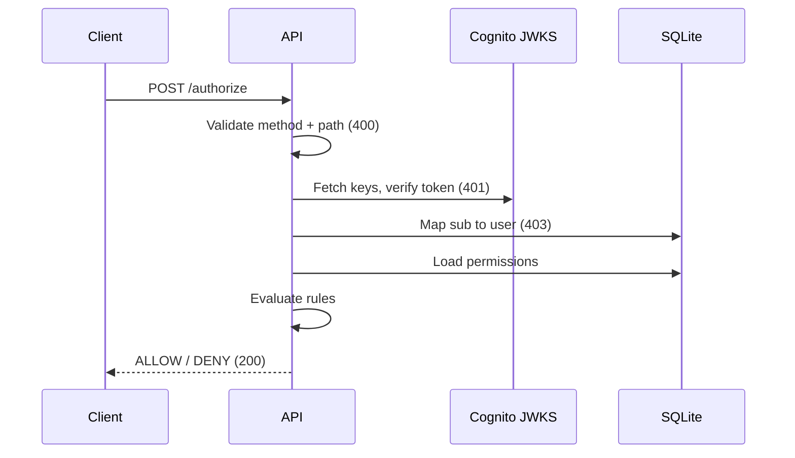
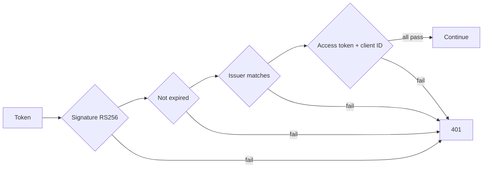
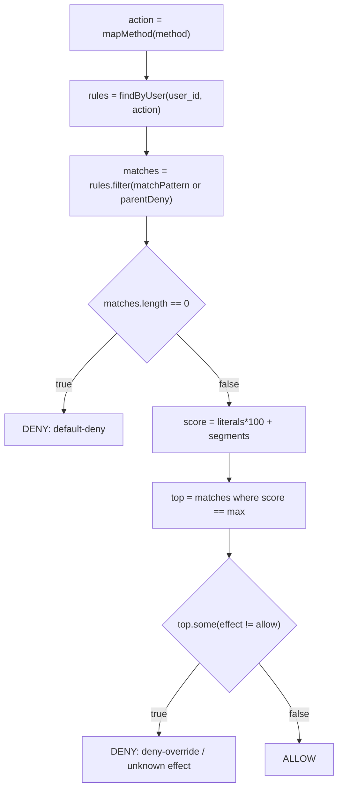
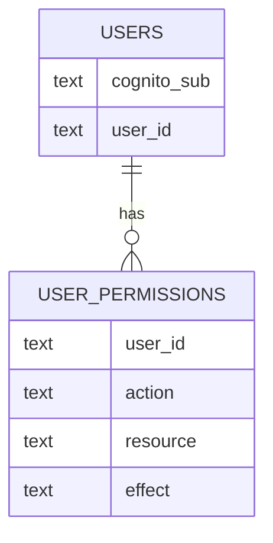

# OpenFabric Authorization Service

A backend-only REST API that checks **who you are** (AWS Cognito access token) and **what you're allowed to do** (permission rules in SQLite), then returns an `ALLOW` or `DENY` decision with a reason.

Built with TypeScript, Express 5, `jose`, and `better-sqlite3`. Created as an OpenFabric technical exercise.

---

## Why this exists

Logging in is not the same as being allowed to do everything. A user who can read transactions shouldn't automatically be able to delete them, and access to one wallet shouldn't open every other wallet.

This service keeps those two concerns apart:

- **Authentication** is handled by AWS Cognito (it issues the token).
- **Authorization** is handled here (we decide what that token's owner can do).

---

## How it works



1. The client gets an access token from Cognito.
2. The client calls `POST /authorize` with the token, an HTTP method, and a resource path.
3. The API verifies the token, maps the Cognito `sub` to an application user, loads that user's rules, evaluates them, and responds.

---

## Features

- JWT validation using Cognito's JWKS (signature, expiry, issuer, token type, client ID)
- Database-backed user mapping and permission lookup
- Wildcard resource matching with specificity scoring
- Deny-override and default-deny behaviour
- Request validation, `helmet` security headers, and rate limiting
- Unit and integration tests with Vitest and Supertest
- Postman collection for manual testing

## Tech stack

| Area | Choice |
|---|---|
| Runtime | Node.js >= 22 (tested on v24.12.0) |
| Language | TypeScript 7 |
| Framework | Express 5 |
| Database | SQLite via `better-sqlite3` 13 (prebuilt binaries, no compiler needed) |
| Auth | `jose` (JWKS-based JWT verification) |
| Testing | Vitest, Supertest |

---

## Project structure

```
openfabric-auth-service/
├── backend/
│   ├── src/
│   │   ├── config/          # DB connection, init and check scripts
│   │   ├── controllers/     # Route handlers
│   │   ├── repositories/    # SQLite queries
│   │   ├── routes/          # Router definitions
│   │   ├── services/        # Authorization logic + token validation
│   │   ├── utils/           # Method mapper, path normalizer
│   │   ├── app.ts           # Express app factory
│   │   └── server.ts        # Entry point
│   ├── database/
│   │   ├── schema.sql       # Tables and indexes
│   │   └── seed.sql         # Sample permissions for development
│   ├── tests/               # Unit + integration tests
│   ├── .env.example
│   ├── package.json
│   └── tsconfig.json
├── postman/                 # Postman globals
├── .postman/                # Postman workspace config
└── README.md
```

---

## Prerequisites

| Requirement | Version |
|---|---|
| Node.js | >= 22 (v24.12.0 recommended) |
| npm | >= 10 |
| AWS Cognito | A User Pool and an App Client |

> `better-sqlite3` v13 ships prebuilt N-API binaries for Windows x64, Linux x64/arm64 and macOS, so you don't need Visual Studio build tools or `node-gyp`.

---

## Installation & Setup

### 1. Go to the backend folder

```bash
cd backend
```

### 2. Install dependencies

```bash
npm install
```

### 3. Configure environment variables

```bash
cp .env.example .env
```

Open `backend/.env` and fill in your own Cognito values:

```dotenv
AWS_REGION=your-aws-region
COGNITO_USER_POOL_ID=your-user-pool-id
COGNITO_CLIENT_ID=your-app-client-id
# PORT=5000   # optional, defaults to 5000
```

> Never commit `.env` to version control.

### 4. Initialize the database

```bash
npm run db:init
```

This creates `backend/data/permissions.db` from `schema.sql` and loads the sample rows from `seed.sql` if the table is empty. Check what was loaded:

```bash
npm run db:check
```

> Don't re-run `db:init` against a database you care about without checking what it does to existing data first.

### 5. Start the dev server

```bash
npm run dev
```

The service is now at `http://localhost:5000`. Quick check:

```bash
curl http://localhost:5000/api/health
```

### 6. Build for production

```bash
npm run build
npm start
```

Compiled output goes to `backend/dist/`.

---

## API

### `GET /api/health`

```json
{
  "status": "OK",
  "message": "OpenFabric Authorization Service is running"
}
```

### `POST /authorize`

Request:

```json
{
  "access_token": "<valid Cognito access token>",
  "method": "GET",
  "path": "/transactions"
}
```

| Field | Notes |
|---|---|
| `access_token` | OAuth 2.0 access token from the configured Cognito User Pool |
| `method` | `GET`, `POST`, `PUT`, `PATCH` or `DELETE` (case-insensitive) |
| `path` | Starts with `/`; segments may only use letters, numbers, `-` and `_` |

Response:

```json
{
  "decision": "ALLOW",
  "user_id": "user123",
  "reason": "A matching allow permission grants access",
  "matched_permissions": [
    {
      "user_id": "user123",
      "action": "read",
      "resource": "transactions",
      "effect": "allow"
    }
  ]
}
```

Try it with curl:

```bash
curl -X POST http://localhost:5000/authorize \
  -H "Content-Type: application/json" \
  -d '{"access_token":"YOUR_ACCESS_TOKEN","method":"GET","path":"/transactions"}'
```

Don't paste real tokens into code, screenshots, or logs.

### Status codes

| Code | Meaning |
|---|---|
| 200 | Decision returned (`ALLOW` or `DENY`) |
| 400 | Missing/invalid fields, unsupported method, or invalid path |
| 401 | Token validation failed (invalid, expired, wrong issuer/client) |
| 403 | Token is valid but no application user is mapped to it |
| 500 | Internal authorization error |

---

## Request flow

What happens, in order, when `/authorize` is called:



### Token validation



---

## Authorization design

### Method to action

| HTTP method | Permission action |
|---|---|
| GET | read |
| POST, PUT, PATCH | write |
| DELETE | delete |

Anything else (HEAD, OPTIONS, TRACE, CONNECT...) gets a 400.

### Path validation

The `path` must start with `/` and can't contain repeated or trailing slashes, `.` / `..` segments, query strings, fragments, percent-encoding, backslashes, or null bytes. Bad paths are rejected before anything else runs.

### Wildcards

- `*` on its own matches any resource.
- `wallets/*` matches `wallets` and everything under it (`wallets/wallet-789/transactions`).
- `wallets/*` does **not** match `wallets-evil/account`. Matching respects segment boundaries.
- `wallets/*/transactions/*` matches positionally, segment by segment.

### How a decision is made



- **Specificity** = `(literal segments x 100) + total segments`. More literals and fewer wildcards means a higher score, and the most specific rule wins.
- On a tie, **deny wins**.
- An unrecognized effect is treated as deny (fail-safe).
- No match at all means **deny**.

### Deny inheritance

An exact `deny` on a parent applies to its children too: denying `transactions` also denies `transactions/txn-456`. An exact parent `allow` does **not** carry down to children.

---

## Database



`USERS` links a Cognito identity to an internal user. `USER_PERMISSIONS` holds the `resource` / `action` / `effect` rules. Because access lives in data, changing who can do what means editing rows, not code. See `backend/database/schema.sql` for the exact definitions.

---

## Running tests

From `backend/`:

```bash
npm test
npm run build   # type-check
```

The suite covers:

- Authorization logic: specificity, deny override, wildcards, default deny, parent-deny inheritance
- Edge cases: conflicting rules, unknown effects, invalid resources
- HTTP integration with mocked token, user mapping and permissions
- Path normalization: accepted and rejected patterns
- Token validation: empty and malformed tokens

---

## Security notes

- Identity comes from the validated token, never from a caller-supplied user ID.
- Keep `.env` and Cognito credentials out of version control.
- Use HTTPS anywhere beyond local development.
- Restrict CORS to trusted origins before deploying.
- Don't log access tokens or other secrets.
- Review permission changes carefully; they directly change access decisions.

## Possible next steps

- Structured audit logs of decisions (without tokens)
- Admin-only APIs for managing permissions
- Dockerized setup
- Stricter CORS, HTTPS and monitoring for production
- Caching, only if permission changes can't leave stale decisions behind

## License

Created as an OpenFabric technical exercise.
